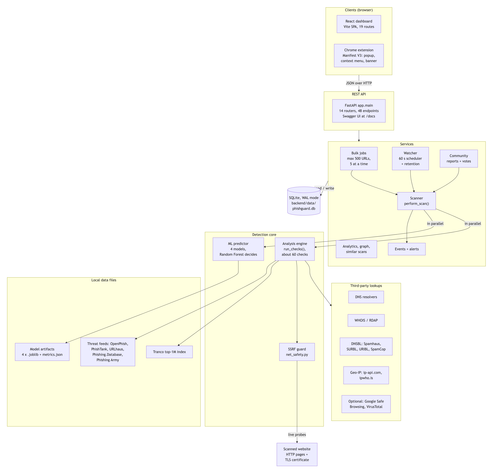

# PhishGuard architecture

This page is a short, readable tour of how PhishGuard (*AI-Based Phishing Website Detection and Risk Analysis System Using Machine Learning*) is built. The detailed material lives next to it in [`docs/architecture/`](architecture/), and the [README](../README.md) carries all of it inline as well:

| If you want | Read |
|---|---|
| The 7 diagrams (Mermaid, rendered by GitHub) | [`architecture/diagrams.md`](architecture/diagrams.md) |
| The same diagrams as images (for slides or a report) | [`architecture/img/`](architecture/img/): [system](architecture/img/system-architecture.png) · [scan pipeline](architecture/img/scan-pipeline-sequence.png) · [ML pipeline](architecture/img/ml-pipeline.png) · [risk scoring](architecture/img/risk-scoring.png) · [database](architecture/img/database-er.png) · [deployment](architecture/img/deployment.png) · [frontend routes](architecture/img/frontend-routes.png) |
| Every library, version, data source and why it is used | [`architecture/tech-stack.md`](architecture/tech-stack.md) |
| All 48 REST endpoints | [`architecture/api-endpoints.md`](architecture/api-endpoints.md) (live: [Swagger UI](https://phishguard-mini-project.vercel.app/docs)) |
| The ML results and the risk formula, step by step | README: [Machine learning](../README.md#-machine-learning) · [Risk scoring](../README.md#-risk-scoring) |
| Deploying the demo | [`DEPLOY_NOTES.md`](DEPLOY_NOTES.md) |
| Presenting the project | [`DEMO_GUIDE.md`](DEMO_GUIDE.md) |

## The big picture

PhishGuard is a three-tier web application. Two browser clients, the **React dashboard** and a **Chrome extension** (Manifest V3), talk JSON to one **FastAPI REST API** with 48 endpoints in 14 routers. Every scan, whether it comes from the dashboard, the extension, a bulk job, the watchlist scheduler or a community report, goes through the same `perform_scan()` pipeline in [`backend/app/services/scanner.py`](../backend/app/services/scanner.py). All state lives in one **SQLite** database. Only the analysis engine talks to the internet: the threat feeds, the Tranco top-1M index and the trained models are local files. The same code runs on a laptop (Uvicorn + Vite) and as the hosted demo on Vercel (one Python function in demo mode). See [diagram 1](architecture/diagrams.md#1-high-level-system-architecture).

## The life of a scan

1. **Validate.** The URL is trimmed, `http://` is added when the scheme is missing, and anything that is not `http`/`https` with a valid host and TLD is rejected with HTTP 422.
2. **Analyse in parallel.** `asyncio.gather` runs three tasks at once: the **ML predictor** (in a worker thread), the **analysis engine** (`run_checks()`) and a lookup in the **local threat feeds**. The engine's first step is the SSRF guard: a host that resolves to a non-public address is never contacted.
3. **Score.** [`backend/app/scoring.py`](../backend/app/scoring.py) blends the two halves, `risk = round(0.6 × ML probability × 100 + 0.4 × heuristic score)`, raises it to at least 90 for a blocklist hit and to at least 85 for a verified community report, and caps popular or official domains at 30 when nothing lists them (never on hosting platforms such as `vercel.app`). It then sets the verdict (thresholds 35 and 65, adjustable in Settings), the trust score, the tier, the threat type, the positive and negative factors and the plain-English summary.
4. **Store and notify.** The result is saved as indexed columns plus the full JSON, the page HTML is kept gzipped (up to 500 KB), an activity-log event is written, and a high-risk phishing result raises an alert.

A quick scan (`deep: false`), or a scan with network checks turned off, runs only the URL-based checks, the feeds and the model and is marked `tested_depth: lexical`. See diagrams [2](architecture/diagrams.md#2-scan-pipeline-post-apiscan) and [4](architecture/diagrams.md#4-risk-scoring-decision-flow).

## The detection core

- **Machine learning** ([`backend/ml/`](../backend/ml)). Four scikit-learn classifiers (Logistic Regression, Decision Tree, Random Forest, SVM) read 44 lexical features of the URL string. Random Forest has the best test F1 (0.856, ROC-AUC 0.945) and drives the score; the other three are shown for comparison. Explanations come from perturbation: each feature is reset to the median legitimate value and the change in probability is its impact. The models are trained offline by `ml/train.py` from local snapshots (146,364 URLs, split by campaign so no campaign is in both train and test). See [diagram 3](architecture/diagrams.md#3-ml-training-and-inference-pipeline).
- **Analysis engine** ([`backend/app/analysis/`](../backend/app/analysis)). 50+ checks in 7 categories: lexical, domain (DNS, WHOIS with an RDAP fallback), network, SSL/TLS, HTTP and page content, brand impersonation (92 brands) and reputation (five local feeds with about 657,000 entries, five DNS blocklist zones, Tranco rank, optional Google Safe Browsing / VirusTotal keys). Every lookup has its own timeout and a failure becomes an `error` check, never a crash. Failed and warning checks add up to the heuristic score `100 × (1 − e^(−raw / 18))`, with floors for strong signals and caps for official and top-10k domains.

## State and background work

The database ([`backend/app/db.py`](../backend/app/db.py), WAL mode) has 11 tables: `scans`, `scan_dom`, `reports`, `votes`, `watchlist`, `watch_checks`, `alerts`, `events`, `bulk_jobs`, `bulk_items` and `settings`. Relations are kept by the application code ([diagram 5](architecture/diagrams.md#5-database-er-diagram)). Background work runs on the API's event loop: a 60-second scheduler for watchlist re-checks, typosquat monitoring and data retention; bulk workers that scan up to 500 URLs per job, 5 at a time, and resume after a restart; feed downloads; and a one-time demo seed for an empty database.

## The clients

- **Dashboard** ([`frontend/`](../frontend)). React 19 + TypeScript, built with Vite and styled with Tailwind CSS. [`App.tsx`](../frontend/src/App.tsx) lazy-loads 17 pages on 19 routes inside one layout (sidebar, quick-scan box, alerts bell, theme toggle, demo banner). TanStack Query keeps live views fresh: Overview live stats every 5 s, a running bulk job every 2 s, the alerts bell every 20 s and the API health every 30 s. The scan report has 15 tabs, from Summary and ML Explanation to Source, Graph and Timeline. See [diagram 7](architecture/diagrams.md#7-frontend-route-map).
- **Chrome extension** ([`extension/`](../extension)). Plain JavaScript, no build step. It quick-scans pages as you browse (cached for 30 minutes), shows the risk score on the toolbar badge, notifies you about phishing pages, can inject a warning banner, adds a "Scan link with PhishGuard" context-menu item and runs a deep scan from its popup. By default it may only reach `localhost:8000`.

## Local run and hosted demo

Locally, [`start.sh`](../start.sh) starts Uvicorn on port 8000 (API, scheduler, demo seed) and the Vite dev server on port 5173, which proxies `/api/`, `/docs`, `/redoc`, `/openapi.json`, `/static` and `/screenshots` to the API. The live demo at <https://phishguard-mini-project.vercel.app> serves the built dashboard from Vercel's CDN and runs the unchanged FastAPI app in one Python function ([`api/index.py`](../api/index.py) → [`deploy/cloud_app.py`](../deploy/cloud_app.py)). On every cold start the bundled `deploy/seed.db` is copied to `/tmp`, so the demo data resets. The scheduler is off and a daily Vercel Cron call at 02:30 UTC runs up to 5 watchlist checks and the retention cleanup. WHOIS data comes from RDAP, and the optional API keys are removed from the snapshot. See [diagram 6](architecture/diagrams.md#6-deployment-local-vs-vercel) and [`DEPLOY_NOTES.md`](DEPLOY_NOTES.md).

## Safety by design

- **SSRF guard** ([`net_safety.py`](../backend/app/analysis/net_safety.py)): only `http`/`https` on ports 80, 443, 8080 and 8443, and every resolved address must be public. The connection is pinned to the checked IP and every redirect hop is checked again, so neither DNS rebinding nor a redirect can reach an internal machine.
- **Hostile content is never executed:** pages are fetched with an HTTP client (at most 2 MiB read), never rendered, and the report's Source tab shows the stored HTML as escaped text.
- **Bounded work:** per-lookup timeouts and an overall scan budget, at most 500 URLs per bulk job, and CSV exports protected against spreadsheet formula injection.
- **Secrets:** the optional Google Safe Browsing and VirusTotal keys are masked in API responses.

PhishGuard is an educational prototype: it has no user accounts and no rate limiting, so a local instance should not be exposed to the internet as-is. Environment variables and runtime settings are listed in the README under [Environment variables](../README.md#environment-variables).
