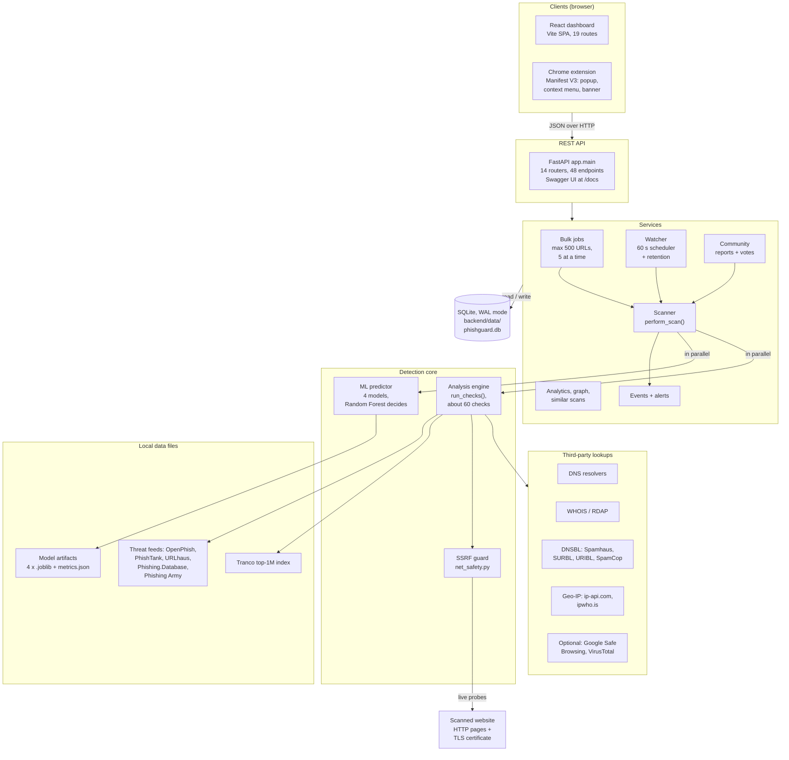
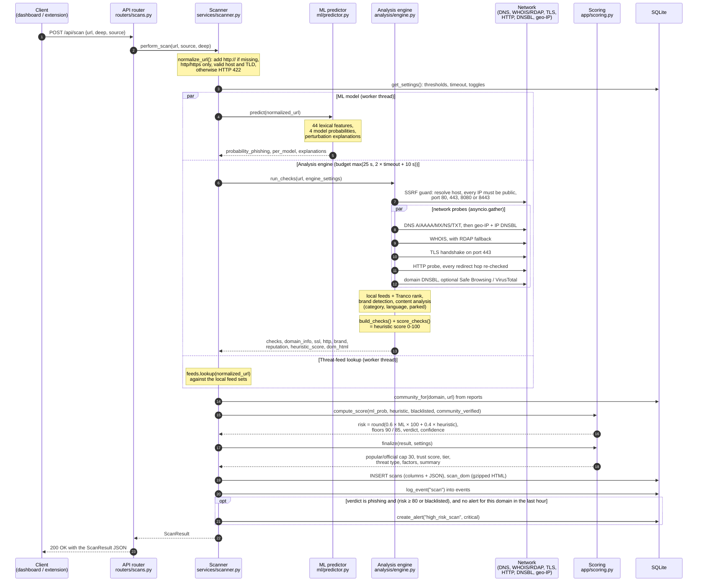
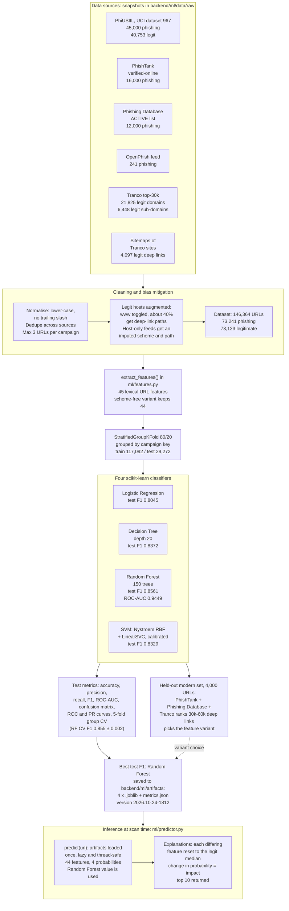
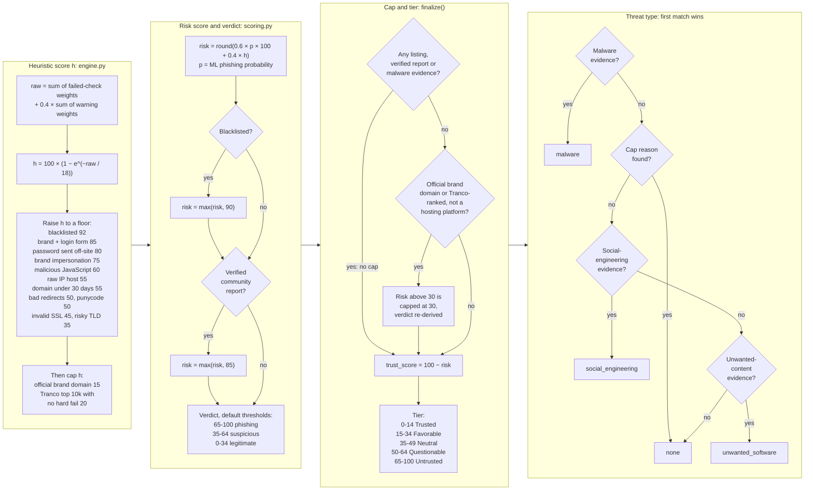
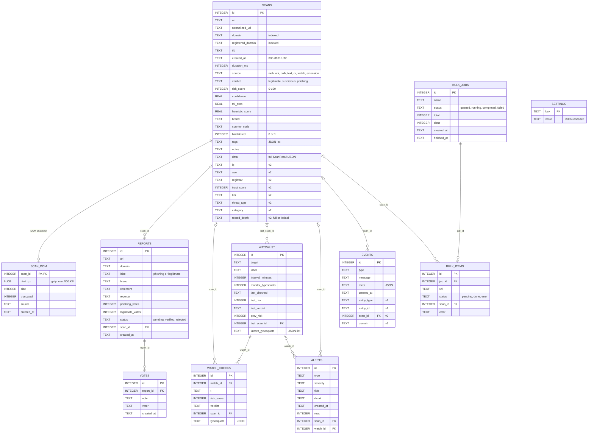
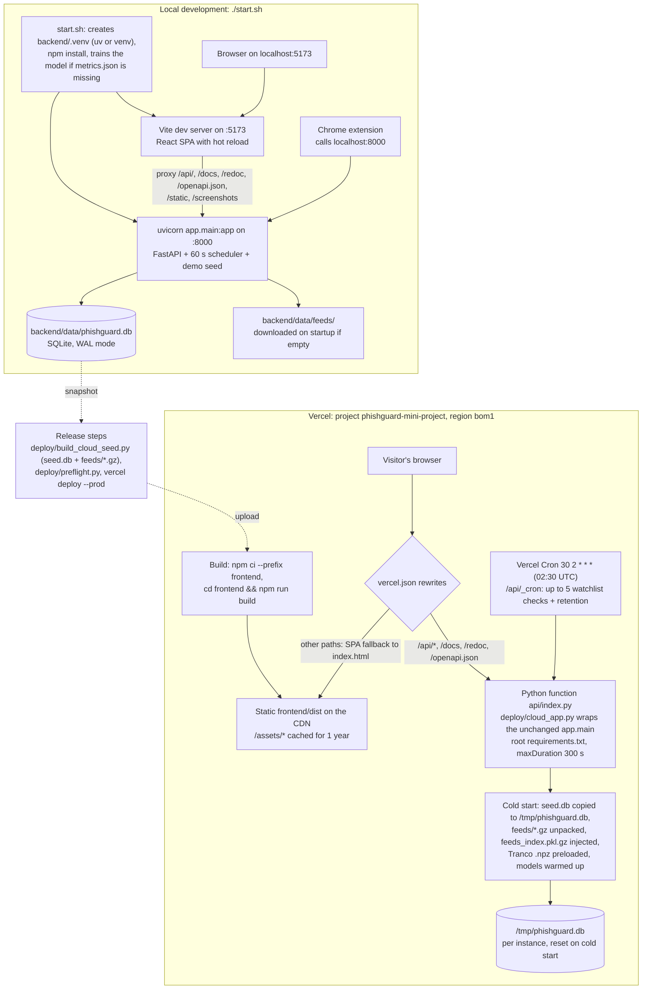
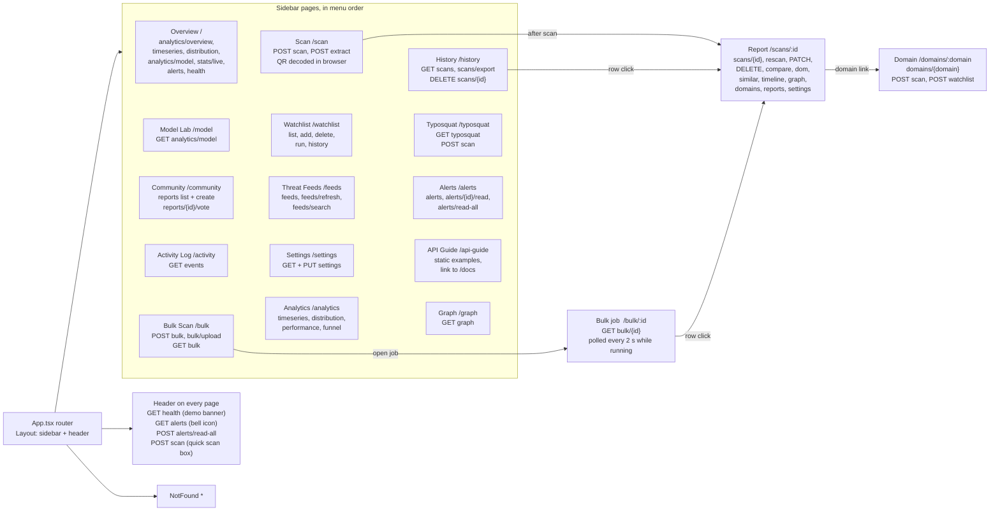

# PhishGuard architecture diagrams

These diagrams cover **PhishGuard — AI-Based Phishing Website Detection and Risk Analysis System Using Machine
Learning** (B.Tech mini project). They were drawn from the source code (`backend/app`, `backend/ml`, `frontend/src`,
`deploy/`, `vercel.json`). File and function names in the labels point to the code that does each step.

GitHub renders the Mermaid blocks directly. Each diagram also has a static PNG in [`img/`](img/) (rendered with
Mermaid 11.4.1) for viewers that do not support Mermaid, such as Word, PDF exports or slides.

| # | Diagram | PNG |
|---|---------|-----|
| 1 | [High-level system architecture](#1-high-level-system-architecture) | [system-architecture.png](img/system-architecture.png) |
| 2 | [Scan pipeline (sequence)](#2-scan-pipeline-post-apiscan) | [scan-pipeline-sequence.png](img/scan-pipeline-sequence.png) |
| 3 | [ML training and inference pipeline](#3-ml-training-and-inference-pipeline) | [ml-pipeline.png](img/ml-pipeline.png) |
| 4 | [Risk scoring decision flow](#4-risk-scoring-decision-flow) | [risk-scoring.png](img/risk-scoring.png) |
| 5 | [Database ER diagram](#5-database-er-diagram) | [database-er.png](img/database-er.png) |
| 6 | [Deployment: local vs Vercel](#6-deployment-local-vs-vercel) | [deployment.png](img/deployment.png) |
| 7 | [Frontend route map](#7-frontend-route-map) | [frontend-routes.png](img/frontend-routes.png) |

Related references: [tech-stack.md](tech-stack.md) (libraries and versions) and [api-endpoints.md](api-endpoints.md)
(all 48 REST endpoints).

---

## 1. High-level system architecture

PhishGuard is a three-tier web application. There are two browser clients: the React dashboard and a Manifest V3
Chrome extension. Both call one FastAPI REST API (48 endpoints in 14 routers). Every scan goes through the same
`perform_scan()` pipeline, whether it comes from the dashboard, the extension, a bulk job, the watchlist scheduler
or a community report. That pipeline runs the ML predictor and the analysis engine side by side. Only the engine
talks to the internet. Live probes of the scanned site (HTTP and TLS) go through the SSRF guard, while DNS,
WHOIS/RDAP, DNSBL and geo-IP are third-party lookups. Threat feeds and the Tranco list are local files, and all
state is kept in one SQLite database.

<!-- diagram: system-architecture -->

---

## 2. Scan pipeline (`POST /api/scan`)

`perform_scan()` in `services/scanner.py` first checks and normalises the URL. Then it runs three tasks at the same
time with `asyncio.gather`: the ML prediction (in a thread), the analysis engine, and a threat-feed lookup on the
API side. Inside the engine the SSRF guard runs first. If the host resolves to a private address or uses a port
that is not allowed, the TLS and HTTP probes are skipped and a `private_network_host` check is added. The scores
are combined in `app/scoring.py`. The result is stored as indexed columns plus the full JSON document, and an event
(and sometimes a critical alert) is written before the `ScanResult` is returned. With `deep=false`, or with network
checks turned off in Settings, only the URL-based checks and the ML model run, and the result is marked
`tested_depth = lexical`.

<!-- diagram: scan-pipeline-sequence -->

---

## 3. ML training and inference pipeline

Training (`python -m ml.train`, about 100 s) reads only local snapshots under `backend/ml/data/raw/`. After
deduplication and bias fixes, the dataset has 146,364 URLs. It is split by *campaign key* (registered domain, or the
tenant host on free-hosting platforms), so no campaign appears in both train and test. All four models are trained
twice, with and without the `uses_https` feature. The scheme-free variant (44 features) was kept because it is more
robust on a held-out "modern" set of 4,000 URLs. Random Forest has the best test F1 and makes the decision. The other
three models are still shown on every scan report.

<!-- diagram: ml-pipeline -->

---

## 4. Risk scoring decision flow

The final risk score combines the ML probability (60%) with the engine's heuristic score (40%). A hit on any
blocklist raises the score to at least 90, and a verified community report raises it to at least 85. `finalize()`
then caps the score at 30 for popular or official domains, but only when nothing lists them and there is no malware
evidence. It also derives the trust score, the reputation tier and the threat type, with malware taking precedence
over social engineering and unwanted software. Confidence (not drawn) is the distance from the nearest threshold,
and it is at least 0.9 when a blocklist or verified report decided the score. Note: the popularity cap checks the
`popular_site` check, which passes for any domain that has a Tranco rank. So in practice it applies to every Tranco
top-1M domain, not only the top 10k mentioned in the code's docstring.

<!-- diagram: risk-scoring -->

Evidence used by the threat-type step (`malware_evidence`, `social_evidence` and `unwanted_evidence` in
`app/scoring.py`):

| Threat type | Evidence |
|---|---|
| `malware` | Listed as malware by an engine (URLhaus), or the URL path ends in an executable or archive extension (`.exe`, `.apk`, `.zip`, ...) and the verdict is not legitimate |
| `social_engineering` | Listed as phishing by an external engine or feed, impersonates a brand (and is not a defensive redirect), has a login/password form while the verdict is not legitimate, or the verdict is phishing |
| `unwanted_software` | Parked domain, SEO spam or hidden iframe, or a spam-blocklist listing when the verdict is not legitimate |
| `none` | None of the above, or the domain has a popular/official cap reason |

---

## 5. Database ER diagram

There are 11 tables in one SQLite file (stdlib `sqlite3`, WAL mode, one connection per thread). `SCHEMA` in
`app/db.py` creates the v1 tables. `migrate()` adds the v2 columns (marked "v2") and the `scan_dom` table, and it is
safe to run more than once. The relationships are kept by the application code only: SQLite foreign keys are turned
off and no `REFERENCES` clauses are declared. `scans.data` holds the complete `ScanResult` JSON, and the other
`scans` columns are indexed copies used for filters, pivots and analytics.

<!-- diagram: database-er -->

---

## 6. Deployment: local vs Vercel

On a laptop, `./start.sh` starts two processes. The first is `uvicorn` on port 8000, which runs the API, the 60 s
watchlist scheduler and the startup demo seed. The second is the Vite dev server on port 5173, which proxies the API
paths to port 8000. The Chrome extension talks to port 8000 directly. The hosted demo (Vercel project
`phishguard-mini-project`, region `bom1`) serves the built SPA from the CDN and runs the *unchanged* FastAPI app
inside one Python function through `deploy/cloud_app.py`. On a cold start, that wrapper copies the bundled
`deploy/seed.db` to `/tmp`, so demo data resets on every cold start. The scheduler is off in the cloud, and a daily
Vercel Cron call to `/api/_cron` does the watchlist re-checks and data retention instead.

<!-- diagram: deployment -->

---

## 7. Frontend route map

`App.tsx` lazy-loads one chunk per page inside a shared `Layout`, which has the sidebar and the header. The sidebar
lists 14 pages, plus the API Guide link at the bottom. Three detail routes are opened from tables and links. The
labels show the backend endpoints each page calls (all under `/api`), taken from the `api` / `apiV2` calls in
`frontend/src/pages`. Data fetching uses TanStack Query. Live views poll: Overview live stats every 5 s, a running
bulk job every 2 s, the header alert bell every 20 s and health every 30 s.

<!-- diagram: frontend-routes -->

