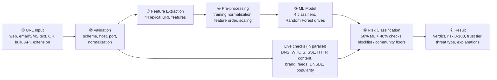

## 📖 About the project

### Problem statement

Phishing websites copy real login, banking and payment pages to steal usernames, passwords and card details. A good copy is hard to tell from the real site, and checking a URL by hand needs technical knowledge that most users do not have. Blocklists help, but a phishing site set up this morning is usually not on any list yet, and many phishing pages are taken down again within hours.

PhishGuard addresses this by **learning what phishing URLs look like**. It extracts features from the URL, scores them with trained machine-learning models, and backs the prediction with live checks of the website itself: domain age, DNS, the SSL certificate, redirects, login forms, brand look-alikes and threat-intelligence feeds. Every URL is classified as **Legitimate**, **Suspicious** or **Phishing**, with a 0-100 risk score and the reasons behind it.

### Objectives

Condensed from the project synopsis:

| # | Objective | How PhishGuard meets it |
|---|---|---|
| 1 | Detect phishing websites with machine learning, by analysing their URLs and related characteristics | A trained classifier scores every URL, and live website checks add evidence the URL alone cannot show |
| 2 | Build a reliable labelled dataset of legitimate and phishing URLs | **146,364 URLs** (73,241 phishing, 73,123 legitimate) from PhiUSIIL, PhishTank, Phishing.Database, OpenPhish, the Tranco list and public sitemaps |
| 3 | Extract meaningful URL features | **44 lexical features**: lengths, dots, hyphens, `@`, digits, sub-domains, entropy, suspicious keywords and TLDs, shorteners, IP hosts, punycode, brand tricks and more |
| 4 | Pre-process the data for classification | De-duplication, at most 3 URLs per phishing campaign, identical URL normalisation, a group-aware 80/20 split (no domain in both train and test), feature scaling where the model needs it |
| 5 | Train and compare **Logistic Regression, Decision Tree, Random Forest and SVM** | All four are trained and evaluated on the same split and compared on accuracy, precision, recall, F1 and ROC-AUC on the Model Lab page |
| 6 | Select the best model | **Random Forest** has the highest test F1 (0.856, accuracy 86.4%, ROC-AUC 0.945) and drives the score |
| 7 | Classify each URL as **Legitimate / Suspicious / Phishing** | Verdict thresholds at risk 35 and 65 (adjustable in Settings) |
| 8 | Give a clear risk indication | 0-100 risk score, trust score, five reputation tiers, threat type, and positive and negative factors in plain English |
| 9 | Provide a simple interface where users enter a URL and see its status | A React dashboard: paste a link on the Scan page and get the full report in a few seconds |

### Scope

**In scope**

- Phishing detection for any `http://` or `https://` URL, typed in, pasted from email or SMS text, read from a QR code, uploaded in bulk, sent through the REST API, or sent from the Chrome extension.
- URL-based machine learning (four models), live website analysis, local threat-intelligence feeds and community reports, combined into one explainable score.
- Investigation and monitoring tools around the scans: history, pivots, a relationship graph, a typosquat finder, a watchlist with alerts, and analytics.
- Running locally on macOS, Linux or Windows, and as a public demo on Vercel (demo mode on a bundled snapshot of demo data).

**Out of scope**

- Scanning email bodies or attachments (the app only *extracts URLs* from pasted text) and analysing downloaded files for malware.
- Running the page's JavaScript in a real browser: pages are fetched with an HTTP client and inspected statically, and the optional screenshot comes from an external service.
- User accounts, API keys and rate limiting: PhishGuard is a single-user project app.
- Taking phishing sites down or reporting them to registrars and hosts.

### How it works

The workflow from the synopsis, as implemented:

1. **URL Input.** A URL arrives from the Scan page (single URL, email/SMS text or QR code), a bulk job (up to 500 URLs, scanned 5 at a time in the background), the REST API (`POST /api/scan`) or the Chrome extension. Pasted text can contain several links, including defanged ones such as `hxxp://evil[.]com`, and each one is extracted. The source of every scan (web, text, QR, bulk, API, watchlist or extension) is recorded.
2. **Validation.** The input is trimmed and checked: it must not be empty, contain whitespace or be longer than 4,096 characters. `http://` is added when no scheme is given, only `http` and `https` are accepted, and the URL must have a host with valid labels, a real-looking top-level domain and a valid port. Default ports and the `#fragment` are dropped. Invalid input is rejected with HTTP 422 and a clear message. For the model, the URL is normalised exactly like the training data (trimmed, lower-case, trailing slash removed).
3. **Feature Extraction.** The normalised URL is turned into **44 numeric features**: lengths of the URL, host, path and query, counts of dots, hyphens, `@`, `?`, `=`, digits and special characters, digit ratio, number and length of sub-domains, domain entropy and vowel ratio, IP-address hosts, punycode, ports, `//` redirects, suspicious keywords (`login`, `verify`, `secure`, ...), high-risk TLDs, URL shorteners, free hosting, brand names in the wrong place, brand typosquats, embedded domains, token statistics, path depth, file extensions, percent-encoding and URL entropy. The `https` scheme is deliberately **not** a feature, because most modern phishing sites use HTTPS and the model must not learn "HTTPS means safe".
4. **Pre-processing.** The features are placed in exactly the order used in training. Logistic Regression and the SVM scale them with the `StandardScaler` fitted on the training set (the SVM also uses a Nystroem kernel approximation), and the tree models use the raw values. Training applied the same steps to the dataset after de-duplication, capping each phishing campaign at 3 URLs and a group-aware 80/20 split.
5. **ML Model.** All four trained classifiers score the URL and return a phishing probability. The best model by test F1, **Random Forest**, drives the score, and the others are shown next to it for comparison. The report lists the features that pushed the probability up or down, with their signed impact.

   **Live checks run in parallel with the model.** While the model runs, the analysis engine checks the website itself, using `asyncio` so the slow network lookups overlap instead of running one after another:
   - **SSRF guard:** the host is resolved first, and private, loopback, link-local and reserved addresses, or ports other than 80, 443, 8080 and 8443, are refused before any connection is made (checked again on every redirect).
   - **DNS** (A, AAAA, MX, NS, TXT, SPF/DMARC), then **WHOIS** with an RDAP fallback, the **SSL/TLS certificate**, the **HTTP probe** (redirect chain, headers, forms, scripts, iframes, page content and resources), **DNS blocklists** (Spamhaus DBL and ZEN, SURBL, URIBL, SpamCop) and the optional Google Safe Browsing and VirusTotal lookups all run at the same time, each with its own timeout.
   - **IP geolocation, ASN and hosting**, **brand impersonation** (92 brands), **content category and language**, the **Tranco popularity rank** and a lookup in the **local threat feeds** (about 657,000 entries) complete the picture.

   Each of the 50+ checks gets a status (pass, warn, fail, info or error) and a weight, and together they give a heuristic score from 0 to 100. A failed or timed-out check is reported as an error and never stops the scan. A *quick scan* skips the network checks and uses only the URL features and the model.
6. **Risk Classification.** The two halves are combined as **risk = round(0.6 × ML probability × 100 + 0.4 × heuristic score)**. A hit on a threat-intelligence blocklist raises the risk to at least **90**, and a community report verified by voters raises it to at least **85**. A very popular or official brand domain with no blocklist hit is capped at **30**, but sites on shared hosting platforms such as `vercel.app` never get this cap. The risk then maps to a verdict:

   | Risk score | Verdict | Reputation tier |
   |---|---|---|
   | 0-14 | 🟢 Legitimate | Trusted |
   | 15-34 | 🟢 Legitimate | Favorable |
   | 35-49 | 🟡 Suspicious | Neutral |
   | 50-64 | 🟡 Suspicious | Questionable |
   | 65-100 | 🔴 Phishing | Untrusted |

   The thresholds 35 and 65 can be changed in Settings, and the tiers move with them. The engine also derives a **trust score** (100 − risk) and a **threat type**: social engineering, malware, unwanted software or none.
7. **Result.** The scan is saved in SQLite, written to the activity log, and raises an alert when the risk is high. The user sees the verdict, risk and trust scores, tier, threat type, confidence, a plain-English summary, the positive and negative factors, the score breakdown, and 15 report tabs (Summary, ML Explanation, Domain, Geo & Hosting, SSL, HTTP, Content, Resources, Brand, Reputation, Screenshot, Source, Graph, Timeline and Raw JSON). API clients and the extension get the same result as JSON.

> [!NOTE]
> The synopsis planned a Streamlit page. The final build uses a React dashboard with a FastAPI REST API instead, so the same engine serves the web UI, the Chrome extension, bulk jobs and scripts.
