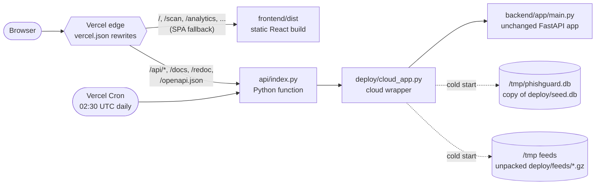

## ☁️ Deployment (Vercel)

The live demo at **<https://phishguard-mini-project.vercel.app>** (Swagger UI at [`/docs`](https://phishguard-mini-project.vercel.app/docs)) is one Vercel project in region `bom1` (Mumbai). It serves the dashboard as static files and runs the **unchanged FastAPI backend** as a single Python serverless function.



### Files involved

| File | Role |
|---|---|
| [`vercel.json`](vercel.json) | installs and builds the frontend (`npm ci --prefix frontend`, `cd frontend && npm run build` → `frontend/dist`), rewrites `/api/*`, `/docs`, `/redoc`, `/openapi.json`, `/static/*` and `/screenshots/*` to the function and every other path to `index.html`, sets a 300 s function timeout, caches `/assets/*` for a year and defines the daily cron |
| [`api/index.py`](api/index.py) | the Python function entry point; adds the repo root to `sys.path` and exposes `deploy.cloud_app.app` |
| [`deploy/cloud_app.py`](deploy/cloud_app.py) | cloud-only wrapper: sets demo-mode environment defaults, copies the snapshot DB to `/tmp`, makes `backend/data` writable through `/tmp`, unpacks the feeds, warms up models/feeds/Tranco, adds `/api/_diag` and `/api/_cron`, then imports `backend/app/main.py` |
| [`requirements.txt`](requirements.txt) (root) | runtime packages of the function, **pinned to the versions that trained the models** (scikit-learn pickles must be loaded by the same scikit-learn version) |
| [`.vercelignore`](.vercelignore) | keeps the upload under the 100 MB CLI limit: no `node_modules`, `.venv`, raw datasets, local DB, extension, scripts or media |
| [`deploy/build_cloud_seed.py`](deploy/build_cloud_seed.py) | builds `deploy/seed.db` from the local database (removes API keys, closes unfinished bulk jobs, shrinks stored HTML) and packs the threat feeds into `deploy/feeds/*.gz` (31 MB → about 8 MB) plus a prebuilt feed index |
| [`deploy/preflight.py`](deploy/preflight.py) | pre-deploy checks: upload and bundle size, requirements against real imports, snapshot freshness; `--smoke` also starts the cloud app locally and calls `/api/health`, `/api/_diag`, `/api/scans` and a deep scan |

### Step by step

1. **Install the Vercel CLI and log in**

   ```bash
   npm i -g vercel
   vercel login
   ```

2. **Link the repository folder to a Vercel project** (run in the repository root; the existing project is `phishguard-mini-project`)

   ```bash
   vercel link --yes --project phishguard-mini-project
   ```

3. **Refresh the cloud snapshot** from your local demo database and feeds (it never modifies `backend/data`)

   ```bash
   backend/.venv/bin/python deploy/build_cloud_seed.py
   ```

4. **Run the pre-flight checks**. The output must end with `PREFLIGHT OK`.

   ```bash
   backend/.venv/bin/python deploy/preflight.py          # add --smoke for a local rehearsal
   ```

5. **Deploy to production**

   ```bash
   vercel deploy --prod
   ```

   Use `vercel deploy` (without `--prod`) for a protected preview deployment first, then `vercel promote <preview-url>` to put it live.

6. **Verify**

   ```bash
   curl -s https://phishguard-mini-project.vercel.app/api/health     # "status":"ok", "cloud":true
   curl -s -H 'content-type: application/json' \
        -d '{"url":"http://paypal-login-verify.secure-account.xyz/update","deep":true}' \
        https://phishguard-mini-project.vercel.app/api/scan            # verdict "phishing", tier "Untrusted"
   ```

7. **Optional:** add a `CRON_SECRET` environment variable in the Vercel project settings. Vercel then sends it as a bearer token to `/api/_cron`. Without it, the endpoint accepts only Vercel's own cron requests.

No Vercel environment variables are required: `deploy/cloud_app.py` sets its defaults with `os.environ.setdefault`, so any variable you add in the project settings wins.

### Demo mode vs. local run

| | Local (`./start.sh`) | Vercel demo mode |
|---|---|---|
| Database | `backend/data/phishguard.db`, permanent | `/tmp/phishguard.db`, copied from `deploy/seed.db` (70 demo scans) on **every cold start** |
| Your scans, reports, watchlist | kept | kept only until the function instance restarts; two visitors can briefly see different data |
| Demo timestamps | real seed times | shifted forward so the "last 24 h / 7 d / 30 d" charts are never empty |
| Demo seeding | on an empty database | off (`PHISHGUARD_NO_SEED=1`), the snapshot already has the data |
| Watchlist checks + retention | background loop every 60 s | off (`PHISHGUARD_NO_SCHEDULER=1`); a **Vercel Cron job at 02:30 UTC** daily (`/api/_cron`) checks up to 5 due watchlist items and applies retention |
| Threat feeds | downloaded and refreshable | snapshot from the last `build_cloud_seed.py` run, unpacked into `/tmp`; a manual refresh lasts only for that instance |
| WHOIS | `whois` binary, RDAP fallback | RDAP (no `whois` binary on Vercel) |
| VirusTotal / Safe Browsing keys | optional, set on Settings | removed from the snapshot, so these integrations are off |
| UI | normal | `/api/health` reports `cloud: true` and the dashboard shows a "Demo mode" banner |
| Extra route | none | `GET /api/_diag` (runtime diagnostics, cold-start timings) |

The first deep scan on a fresh instance can take a few seconds longer while models and feeds load in the background; typical deep scans take 2-4 s. The demo has no login or rate limiting, so do not enter private data or real API keys there.

The full rehearsal notes, with more verification commands and troubleshooting, are in [docs/DEPLOY_NOTES.md](docs/DEPLOY_NOTES.md).
